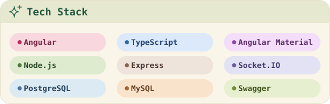

# Hi, I’m Laura Navarro 👋

I build web applications with **Angular** and **TypeScript** and connect them to APIs built with **Node.js** and **Express**. My projects cover hotel bookings, events, and task management.

## Featured Projects

### 🛎️ Roomify

A hotel booking app with an Angular Material interface and a REST API documented with Swagger. It uses PostgreSQL to store booking data.

[Frontend](https://github.com/launav/booking-project) · [API](https://github.com/launav/booking-project-api)

### 🗓️ Events Manager

An event management app built with Angular and Socket.IO for real-time communication between the frontend and server.

[Frontend](https://github.com/launav/events-manager) · [API](https://github.com/launav/events-manager-api)

### ✓ Task Manager

A task management app with an Angular Material interface and an Express API backed by MySQL.

[Frontend](https://github.com/launav/task-manager) · [API](https://github.com/launav/task-manager-api)
